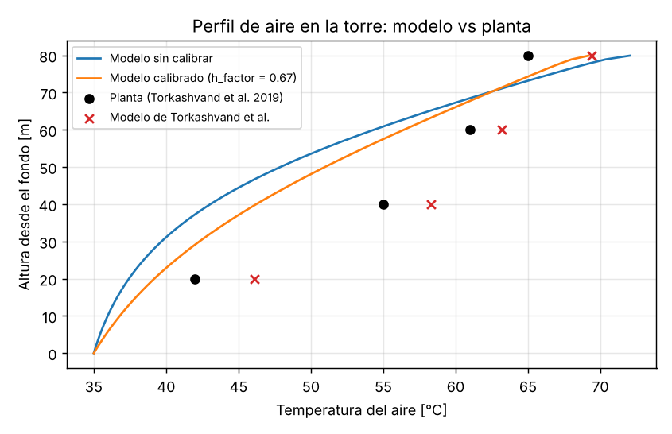

# Torre de prilling: enfriamiento, solidificación y PSD

> Predice si las gotas de urea fundida alcanzan a solidificar antes de llegar al fondo de una torre de prilling, a qué temperatura sale el producto y qué fracción de la distribución de tamaños queda fuera de especificación, en función del diámetro de gota, la altura de la torre y el aire de enfriamiento.

[](https://github.com/vmunozicq/Torre-prilling/actions/workflows/ci.yml)
[](https://torre-prilling.streamlit.app)
[](LICENSE)


**English summary.** A Python model of a urea prilling tower: each droplet size class is tracked as it falls (Clift-Gauvin drag, Ranz-Marshall heat transfer) while an enthalpy-method finite-volume scheme resolves radial conduction and solidification inside the droplet; the classes are coupled to the counter-current cooling air through an iterative energy balance. Verified against exact solutions (sphere conduction series, quasi-steady sphere solidification) and validated against published data from an 80 m industrial tower (Torkashvand et al., 2019): RMSE 5.2 °C with a single calibrated heat-transfer factor, versus 3.8 °C for the authors' own model. The calibrated case also exposes a structural limitation (about 11 % of the mass would still hold liquid at the bottom), which is documented rather than tuned away. A Streamlit app explores droplet size, tower height and air conditions, and reports the product size distribution.

---

## 1. Problema

En una torre de prilling, una gota que llega al fondo con el núcleo líquido se deforma y se aglomera. La altura de la torre y el flujo de aire se fijan en el diseño; en operación solo se mueven la carga, los orificios del balde (el tamaño de gota) y, con suerte, el aire. La herramienta responde qué tamaño de gota solidifica en una torre dada y cuánto producto queda en especificación, sin depender de una planilla de un solo punto ni de un CFD.

## 2. Modelo

Tres piezas, cada una con su fuente (detalle completo en [`docs/modelo.md`](docs/modelo.md)):

| Pieza | Ecuación | Fuente |
| --- | --- | --- |
| Caída de la gota | dv/dt = g(1 − ρa/ρp) − ¾ C_D ρa w\|w\| / (ρp d), con C_D de Clift-Gauvin | Clift, Grace y Weber (1978) |
| Calor en la superficie | Nu = 2 + 0,6 Re^½ Pr^⅓ | Ranz y Marshall (1952) |
| Solidificación | conducción radial con método de entalpía en N capas esféricas | formulación estándar; verificada contra London y Seban (1943) |
| Aire en contracorriente | ṁa [ha(Ta(z)) − ha(Ta,in)] = ṁf Σ wj [H̄j(z) − H̄j(H)] | balance de energía, pared adiabática |
| PSD | Rosin-Rammler; d_gota = 1,89 d_orificio | Rosin y Rammler (1933); Rayleigh (1878) |

Propiedades del aire con CoolProp; de la urea, desde literatura y contrastadas con `thermo`.

## 3. Supuestos y límites

- Flujo de aire uniforme (1D), gotas esféricas sin interacción, movimiento solo vertical.
- Propiedades constantes por fase y solidificación a T_m sin subenfriamiento.
- No modela secado, biuret, aglomeración ni polvo. El nitrato de amonio está disponible como **no validado** (no incluye sus transiciones sólido-sólido).
- Un único parámetro de calibración (`h_factor`), ajustado a la planta de referencia.
- **Datos: solo bibliografía pública.** Ningún dato proviene de empresas donde he trabajado. Fuentes en [`SOURCES.md`](SOURCES.md).

## 4. Validación

**Verificación numérica:** el código reproduce la serie analítica de conducción en una esfera, la exponencial del modelo concentrado, el tiempo de solidificación cuasi-estacionario de una esfera (3 %) y cierra el balance de energía de la torre a 10⁻¹³ ([`tests/test_droplet.py`](tests/test_droplet.py)).

**Validación contra planta:** torre de urea de 79,9 m, 75 t/h (Torkashvand et al., 2019, Tabla 1, [doi:10.2298/CICEQ180827030T](https://doi.org/10.2298/CICEQ180827030T)).

| Variable | Planta | Modelo de los autores | Este modelo, h_factor = 1 | Este modelo, h_factor = 0,61 |
| --- | --- | --- | --- | --- |
| Temperatura del producto (urea) [°C] | 60,0 | 64,5 | 41,8 | 61,5 |
| **RMSE [°C]** | | **3,8** | **11,3** | **5,2** |

Los datos de planta descuadran el balance de energía en 9,5 %, así que ningún modelo adiabático puede ajustar los cinco puntos a la vez. Además, el caso calibrado deja cerca de 11 % de la masa (las gotas más grandes) con líquido residual en el fondo, algo poco creíble en una planta que produce prills sanos. La principal limitación es la forma del perfil de aire (la planta libera más calor en la parte baja); está discutida en [`docs/modelo.md`](docs/modelo.md) §6. El test que fija estos resultados está en [`tests/test_validacion.py`](tests/test_validacion.py).



## 5. Demo

- App en línea: **https://torre-prilling.streamlit.app** (si está dormida, pulsa el botón para despertarla; tarda unos 30 s).
- Mueve el diámetro de gota y la altura en **Gota individual** para ver dónde solidifica; en **Torre completa + PSD** pulsa *Simular torre* y mira qué fracción de la PSD queda en rojo (no solidifica) o naranja (fuera de rango).

### Ejecutar en local

```bash
git clone https://github.com/vmunozicq/Torre-prilling.git
cd Torre-prilling
python -m venv .venv && source .venv/bin/activate
pip install -r requirements.txt -r requirements-dev.txt
pytest
streamlit run app/streamlit_app.py
python scripts/run_all.py   # regenera validación, tornado y figuras (≈ 10 min)
```

## 6. Estructura

```
src/prilling/   núcleo de cálculo (sin Streamlit): propiedades, correlaciones, gota, torre, PSD, sensibilidad, validación
app/            interfaz Streamlit
tests/          pytest: verificación analítica + caso de validación
data/raw/       datos de Torkashvand et al. (2019) con source_id (ver SOURCES.md)
data/resultados/ salidas de scripts/run_all.py que usa la app
docs/           modelo.md, figuras
scripts/        run_all.py
```

## 7. Hecho con Claude Code

Yo definí el problema, las fuentes y el caso de validación, y revisé cada ecuación y supuesto de [`docs/modelo.md`](docs/modelo.md) contra la bibliografía citada. [Claude Code](https://claude.com/claude-code) escribió el código, los tests y la interfaz.

## Licencia y cita

Código bajo licencia [MIT](LICENSE). Los datos conservan la licencia de su fuente original (ver [`SOURCES.md`](SOURCES.md)).

Proyecto personal de Vicente Muñoz, Ingeniero Civil Químico. [LinkedIn](https://www.linkedin.com/in/vicente-mu%C3%B1oz-748aa2230) · [Otros proyectos](https://github.com/vmunozicq)
